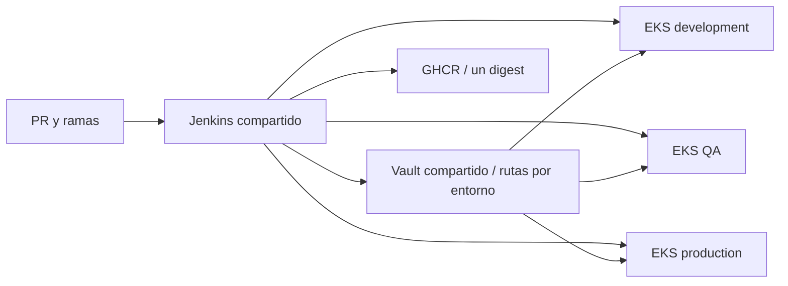

# Jenkins y Vault compartidos

Una instalación en `prueba-devops-jenkins-vault` sirve a development, QA y production. **Sin Helm:** manifiestos propios para Jenkins/Vault y manifiestos oficiales versionados para VSO/CSI.

| Carpeta | Contenido |
|---|---|
| `k8s/` | Jenkins/JCasC, Vault Raft/TLS, almacenamiento y RBAC |
| `images/` | Controller/agente Java 21; plugins fijados para Multibranch y lector de promociones |
| `vault/environments/` | Políticas explícitas development/qa/production |
| `operators/` | VSO y CSI vendorizados, con Kustomize |
| `scripts/` | Instalación y configuración manual |

Vault separa rutas `kv/environments/<entorno>`, políticas y mounts JWT por issuer de clúster. Jenkins obtiene permisos de lectura por rol de entorno; no se crean tres instalaciones Vault. La instalación de operadores se repite en los tres clústeres de aplicación.

Este repo conserva main. Su workflow tiene **2 jobs, 5 pasos**: manifests (checkout/validación) e images (checkout/build/publicación opcional). Solo publica imágenes al solicitarlo manualmente; no despliega. Los scripts requieren `INSTALL_ENABLED=true` y contexto exacto.

## Preparación pendiente

1. Aplicar bootstrap y recuperar herramientas; crear los tres EKS con su plan/aprobación. Se necesita estación con acceso privado a las cuatro API.
2. Publicar imágenes revisadas; crear secretos administrativos, `jenkins-promotion-reader` (username/password de usuario distinto), TLS/CA y GHCR desde archivos privados. Instalar tools con `INSTALL_ENABLED=true` y `CONTROLLER_IMAGE` real.
3. Inicializar/desellar Vault interactivamente. Exportar TOOLS_ISSUER, DEVELOPMENT_ISSUER, QA_ISSUER y PRODUCTION_ISSUER; ejecutar configure-vault.sh. Escribe/reemplaza datos de demo, nunca usarlo con secretos reales. Revocar token administrativo después.
4. En cada clúster de app, preparar namespace/identidades/CA/ghcr-pull; ejecutar `TARGET_ENVIRONMENT=<entorno> INSTALL_ENABLED=true sh scripts/install-development.sh` con contexto exacto. Sustituir DNS Vault por el NLB interno, conservar CA/SAN TLS y autorizar CIDR de evaluación antes de aplicar CR/Service; no aplicar imagen placeholder.
5. Crear Jenkins Multibranch limitado a develop/qa/main, SCM privado, AGENT_IMAGE, registry-credentials, promotion-reader (API token de solo lectura) y kubeconfig-development/qa/production. Los kubeconfigs usan SA jenkins-deployer de cada clúster y tokens temporales; renovar antes de caducar.

JCasC conserva admin y añade lector con Overall/Read + Job/Read. La URL Jenkins actual es HTTP interno: limitar acceso de red y no exponer credenciales fuera de tools. QA/main requieren SOURCE_BUILD_NUMBER de un job previo exitoso y mismo árbol Git; si falta, se detienen. Configurar protecciones/revisión de PR y conservar artefactos hasta terminar promociones.

Estado: código publicado; sin instalación AWS ni publicación de las imágenes nuevas. [Evidencia histórica local](local-demo/README.md). La demo permanece detenida; su éxito anterior no prueba el flujo nuevo de tres entornos. Vault tiene una réplica y unseal manual; no ofrece HA.

Plugins nuevos preparados en código, sin instalación: [Matrix Authorization 3.3](https://plugins.jenkins.io/matrix-auth/) y [GitHub Branch Source](https://plugins.jenkins.io/github-branch-source/). Falta comprobar dependencias, JCasC y pipeline con Jenkins real. Las pruebas de sintaxis no acreditan esa integración.
