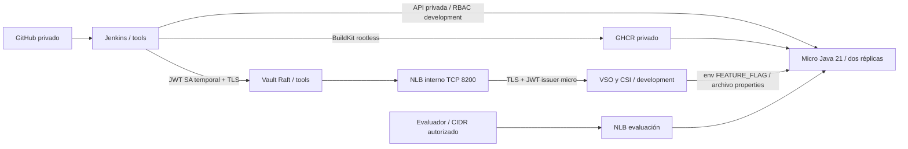

# Jenkins y Vault con manifiestos Kubernetes propios

Repositorio privado de instalación para `prueba-devops-jenkins-vault`, separado de Terraform. **Sin Helm**: StatefulSets, Services, PVC, RBAC y ConfigMaps propios. Los operadores de desarrollo usan manifiestos oficiales versionados con Kustomize, conservando licencias; no se crea un operador propio.

| Ruta | Contenido |
|---|---|
| `k8s/` | Jenkins con JCasC, Vault Raft/TLS, NLB interno, almacenamiento gp3 Retain y RBAC |
| `images/` | Jenkins LTS Java 21 con plugins fijados y agente Java 21/kubectl/jq |
| `operators/` | VSO 1.6.0, Vault CSI provider 1.7.4, Secrets Store CSI driver 1.6.1, procedencia/hash y overlays |
| `vault/` | Políticas de lectura limitada al KV de demostración |
| `scripts/` | TLS local, configuración JWT, instalación explícita y validación |
| `docs/OPERACION.md` | Orden de instalación, credenciales, red entre clústeres y validación de rúbrica |

Seguir [OPERACION.md](docs/OPERACION.md). Los scripts de instalación requieren contexto exacto e `INSTALL_ENABLED=true`; no hay despliegue automático desde GitHub. El workflow valida manifiestos y construye ambas imágenes; sólo una ejecución manual con `publish_images=true` publica paquetes privados en GHCR.

Las imágenes de Jenkins, agente y Java se construyeron localmente; los plugins se resolvieron correctamente. Kustomize renderiza los tres componentes. Kubeconform valida recursos estándar contra Kubernetes 1.36; los CRD oficiales se omiten explícitamente de ese validador, y sus esquemas suministran la validación de CR en el repo micro. No equivale a una instalación integrada: EKS/nodos, PVC, JWT, TLS, NLB y rollback real están pendientes por el bloqueo AWS y la falta de estación con acceso privado. No se afirma puntuación obtenida ni funcionamiento en el clúster.

Vault y Jenkins son de una réplica para la evaluación; Vault requiere unseal manual y no ofrece HA. El agente Jenkins no usa `privileged` ni Docker socket; el driver CSI conserva privilegios de nodo necesarios. No hay secretos reales en archivos versionados. Revisar excepciones y costes detallados en operación.

Fuentes: [VSO](https://developer.hashicorp.com/vault/docs/deploy/kubernetes/vso/api-reference), [Vault CSI](https://developer.hashicorp.com/vault/docs/deploy/kubernetes/csi/configurations), [Secrets Store CSI](https://github.com/kubernetes-sigs/secrets-store-csi-driver/releases/tag/v1.6.1), [NLB en EKS](https://docs.aws.amazon.com/eks/latest/userguide/network-load-balancing.html), [BuildKit rootless](https://github.com/moby/buildkit/blob/master/docs/rootless.md), [Kubeconform](https://github.com/yannh/kubeconform).
